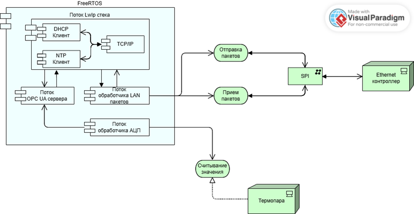
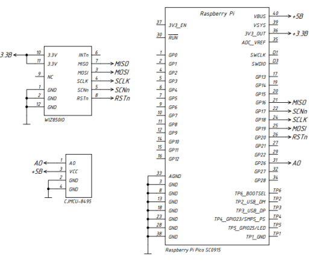
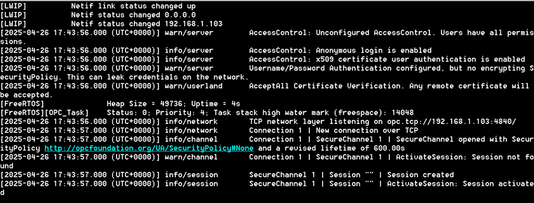
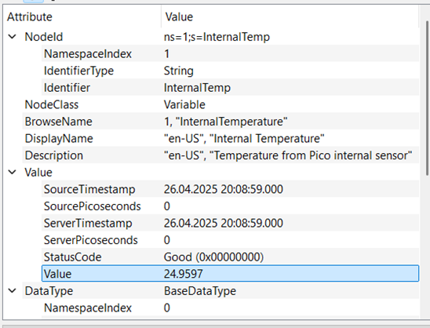

# RP2040 OPC UA Server

A lightweight OPC UA server implementation for the Raspberry Pi Pico (RP2040) platform.

## Features

- Implements core OPC UA server functionality
- Designed for resource-constrained embedded systems
- Can work together with [Autosys](https://github.com/Maronari/Autosys)

## Architecture





## Getting Started

### Prerequisites

- Raspberry Pi Pico (RP2040)
- CMake
- GCC toolchain for ARM Cortex-M0+
- [Pico SDK](https://github.com/raspberrypi/pico-sdk)

### Building

```sh
git clone --recurse-submodules https://github.com/yourusername/RP2040_OPCUA_Server.git 
cd RP2040_OPCUA_Server
mkdir build && cd build
cmake ..
make w5x00_opc_dhcp
```

### Flashing

Use your preferred method to flash the generated `.uf2` file to your Pico.



## Usage

- Connect your OPC UA client to the Pico's IP address (gen get with DHCP) and configured port.
- Browse and interact with exposed nodes.



## License

This project is licensed under the MIT License.

## Acknowledgements

- [open62541](https://github.com/open62541/open62541)
- Raspberry Pi Foundation
