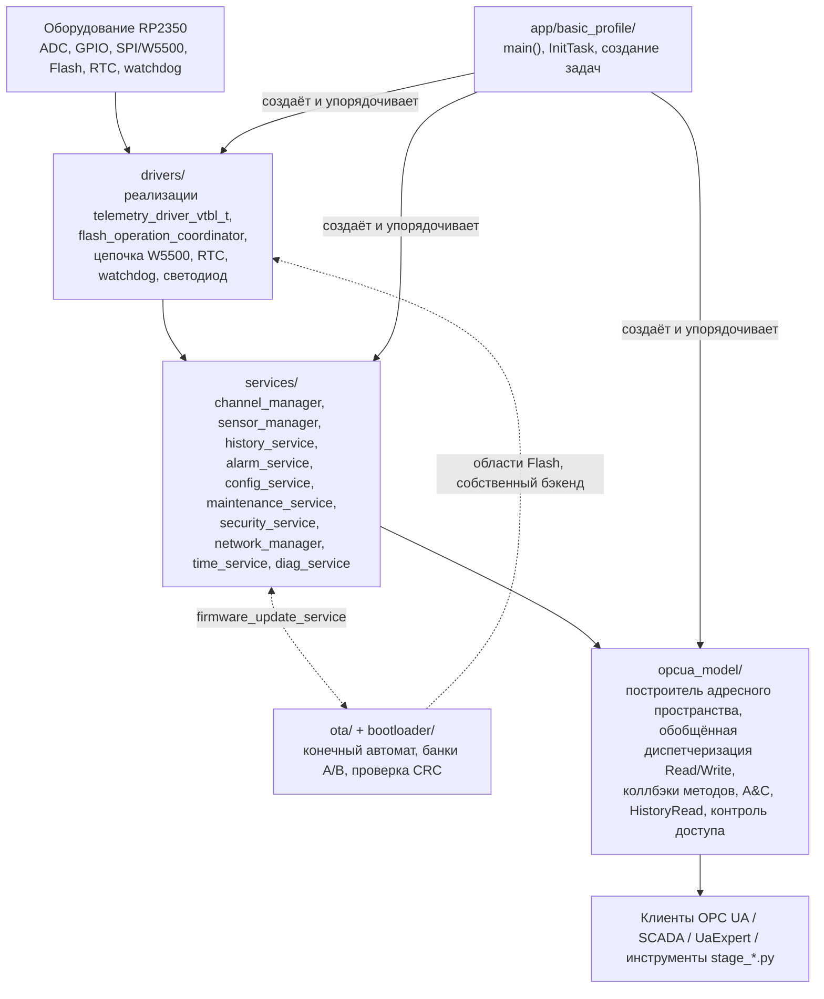

# Архитектура

## Предполагаемая архитектура

Согласно [ROADMAP.md](../../ROADMAP.md) §1 и [AGENTS.md](../../AGENTS.md):

```text
физические драйверы / протоколы полевого уровня
              |
       среда выполнения каналов
              |
конфигурация / история / аварийные сигналы / обслуживание / безопасность / OTA
              |
       информационная модель OPC UA
              |
клиенты, SCADA, CMMS, историки данных и брокеры MQTT
```

Правила: драйверы владеют оборудованием; сервисы владеют бизнес-состоянием
и состоянием времени выполнения и вызывают драйверы; `opcua_model` —
это **адаптер** над состоянием сервисов — он проверяет и преобразует
аргументы, вызывает API сервисов, отображает результаты в коды состояния
OPC UA и не должен содержать собственные конечные автоматы обслуживания/
конфигурации/аварийных сигналов/безопасности/OTA.

## Фактическая архитектура (проверено)



Предполагаемое разделение на слои **подтверждается** для проверенных участков
кода во всех шести проходах картирования подсистем: каждый коллбэк OPC UA и
каждая ветвь обобщённой диспетчеризации Read/Write делегируют вызов сервису;
весь доступ к оборудованию каждого нативного драйвера канала находится в
`drivers/`; историческое нарушение доступа к ADC/GPIO в
`services/driver_catalog.c`, отмеченное в более ранних версиях
`ROADMAP.md`, подтверждено устранённым.

## Классификация зависимостей

| Связь | Тип | Пример |
| --- | --- | --- |
| `opcua_model` → `services` | прямой вызов во время выполнения | `model_write_value` → `channel_manager_write_value` |
| `services` → `drivers` | прямой вызов во время выполнения | `channel_manager` → `telemetry_driver_vtbl_t.read` |
| `services` → `drivers` | коллбэк/vtable | `channel_manager_poll_all` → указатель на функцию `read` драйвера |
| open62541 → `opcua_model` | коллбэк | `UA_DataSource.read/write`, `UA_HistoryDatabase.readRaw`, `UA_TwoStateVariableChangeCallback` |
| `app` → `services`/`opcua_model`/`drivers` | вызов на этапе компиляции + последовательность инициализации | упорядоченные вызовы `*_init()` в `app_init_task` |
| `services` → Flash | сохранение состояния | `config_store_service`, `maintenance_journal_backend`, `history_flash_backend`, `security_service` — все через `flash_operation_coordinator` |
| `drivers` → периферия RP2350 | оборудование | доступ к регистрам ADC/GPIO/SPI/Flash/watchdog/AON-таймера |
| `ota`/`bootloader` → Flash | сохранение состояния + оборудование | копирование банков A/B, запись состояния OTA |
| Цели CMake | этап компиляции | полный граф смежности см. в [build-system.md](build-system.md) |

<a id="confirmed-layering-observations"></a>
## Подтверждённые наблюдения по разделению на слои

Обнаружено путём прямого анализа исходного кода, не исправляется в рамках
этого документационного прохода:

1. **`services/src/diag_service.c` напрямую вызывает `hardware/watchdog.h`**
   (`watchdog_caused_reboot()`, `watchdog_reboot()`) — каждый другой сервис
   в этой кодовой базе, взаимодействующий с оборудованием, вместо этого
   обращается через заголовок `drivers/*`. См.
   [modules/services.md](modules/services.md#confirmed-architecture-boundary-observations).
2. **`services/src/config_store_service.c` читает слоты конфигурации Flash
   через прямое разыменование указателя XIP**, а не через вызов чтения
   драйвера. Записи корректно проходят через
   `flash_operation_coordinator`.
3. **`services/src/security_certificate_group_service.h`/`.c` напрямую
   раскрывают типы open62541** (`UA_CertificateGroup *`, `UA_StatusCode`,
   `UA_NodeId`, `UA_TrustListDataType`) в публичном API `services/`, что
   противоречит цели [AGENTS.md](../../AGENTS.md) о «независимости
   сервисов от типов open62541, где это практически возможно».
4. **Разделение модулей `opcua_model` в v0.4.0 выполнено на уровне файлов, а
   не на уровне API**: один общий внутренний заголовок из 1194 строк
   (`opcua_model_internal.h`) объявляет около 400 функций, вызываемых из
   любого файла модуля, а константы NodeId разбросаны по трём разным
   местам вместо централизации. Несколько имён файлов
   (`model_channels.c`, `model_diagnostics.c`, `model_ota.c`) не отражают
   их фактическое содержимое. Это **организационное** наблюдение — внутри
   самого `opcua_model` нарушений границ сервисов не обнаружено (каждый
   коллбэк по-прежнему делегирует вызов сервису). См.
   [modules/opcua_model.md](modules/opcua_model.md#headline-finding-file-split-not-api-boundary).
5. **Подтверждение работоспособности после OTA не является полноценной
   проверкой работоспособности**, а откат может обнаружить, но не
   восстановиться после неисправного образа — см.
   [ota-bootloader.md](ota-bootloader.md#health-confirmation-and-rollback--current-gap).
   Это соответствует `ROADMAP.md` §5.12 и является задокументированной
   областью работ `v0.6.0`.
6. **`OTA_ROM_PRIMARY_APP`**, требуемый эталонной командой сборки в
   [AGENTS.md](../../AGENTS.md) и передаваемый в CI, нигде не используется
   в относящемся к этой области CMake — по всей видимости, это неактивный
   флаг. См.
   [build-system.md](build-system.md#build-time-feature-options).

Ни одно из этих наблюдений не было исправлено в рамках данной
документационной задачи, согласно её области применения «только чтение,
без изменения поведения».

## Что было проверено и признано корректным

- Нигде в `services/src/*.c` нет доступа к ADC/GPIO/SPI/I2C
  (поиск по всему репозиторию).
- Нет ни одного вызова `flash_range_program`/`flash_range_erase` за
  пределами `drivers/src/flash_operation_coordinator.c`.
- Каждый проверенный коллбэк OPC UA (Read, Write и каждый прослеженный
  Method) делегирует вызов ровно одному сервису, а не изменяет состояние
  напрямую.
- Генерация узлов модели каналов имеет ограниченное временное выделение
  памяти и детерминированный откат при частичном сбое
  (`model_rollback_channel_model`).
- Чтение истории использует ограниченные критические секции на каждый
  фрагмент, а не блокировку на всё сканирование целиком, что соответствует
  ограничению `v0.4.3` из `AGENTS.md`.

## Связанная документация

- [module-map.md](module-map.md) — сводка ответственности по каждому каталогу.
- [call-graphs.md](call-graphs.md) — диаграммы диспетчеризации.
- [state-ownership.md](state-ownership.md) — каждая значимая глобальная переменная.
- `docs/code/topology/TOPOLOGY.html` — интерактивный граф зависимостей
  (получен на основе регулярных выражений; см. поле `observations` для
  оговорок об ограничениях извлечения).
