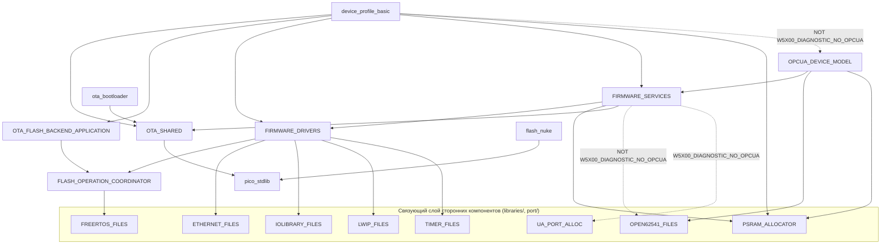

# Система сборки

CMake + Raspberry Pi Pico SDK, кросс-компиляция через `arm-none-eabi-gcc`,
эталонная плата `waveshare_core2350b_16mb_psram8mb`. Точные эталонные
команды конфигурации/сборки Debug см. в разделе «Build and verification»
[AGENTS.md](../../AGENTS.md).

## Реестр CMakeLists.txt

| Файл | Роль |
| --- | --- |
| `CMakeLists.txt` (корневой) | Подключает Pico SDK, заголовки платы, патчи подмодулей; определяет корневые `option()`; выполняет `add_subdirectory` для `libraries`, `port`, `drivers`, `ota`, `services`, `opcua_model` (условно), `app`, `bootloader` (условно), `examples` (условно), `tools/flash_nuke` (условно). |
| `app/CMakeLists.txt` | Только `add_subdirectory(basic_profile)`. |
| `app/basic_profile/CMakeLists.txt` | Определяет цель(и) `device_profile_basic` (стандартная, вариант `_bank_a` для OTA, диагностический вариант `_w5x00_diag`), подготовку идентичности/доверенных сертификатов DER→C-массив, дополнительную цель экспорта конфигурации, распространение версии OTA. |
| `bootloader/CMakeLists.txt` | Исполняемый файл `ota_bootloader` (только при `OTA_BUILD_BOOTLOADER=ON`). |
| `drivers/CMakeLists.txt` | Статические библиотеки `FIRMWARE_DRIVERS` + `FLASH_OPERATION_COORDINATOR`; 3 `option()` для нативных драйверов каналов. |
| `opcua_model/CMakeLists.txt` | Статическая библиотека `OPCUA_DEVICE_MODEL`. |
| `ota/CMakeLists.txt` | Статические библиотеки `OTA_SHARED` + `OTA_FLASH_BACKEND_APPLICATION`. |
| `port/CMakeLists.txt` | Статические библиотеки связующего слоя сторонних компонентов: `IOLIBRARY_FILES`, `PSRAM_ALLOCATOR`, `UA_PORT_ALLOC`, `LWIP_FILES`, `TIMER_FILES`, `OPEN62541_FILES` (загружает MQTT-C, если не установлен `W5X00_DIAGNOSTIC_NO_OPCUA`). |
| `services/CMakeLists.txt` | Статическая библиотека `FIRMWARE_SERVICES`. |
| `examples/CMakeLists.txt` / `examples/opc_dhcp/CMakeLists.txt` | Устаревший монолитный пример, по умолчанию отключён через `BUILD_LEGACY_EXAMPLES=OFF`. |
| `tools/flash_nuke/CMakeLists.txt` | Отдельный исполняемый файл утилиты восстановления `flash_nuke`. |

У `boards/` нет `CMakeLists.txt` — только заголовки, подключаемые через
`PICO_BOARD_HEADER_DIRS`. У `static/tests/` **нет**
регистрации `CMakeLists.txt`/CTest — см. раздел [Тестирование](#testing) ниже.

`cmake/` содержит только `cmake/firmware_version.cmake` — единственный
авторитетный источник семантической версии
(`RP2_FIRMWARE_VERSION`, в настоящий момент `0.5.1`), упаковываемый в
`RP2_FIRMWARE_VERSION_NUMBER` и используемый в `project(... VERSION ...)`,
`pico_set_program_version()` и
`DEVICE_PROFILE_FW_REVISION`/`OTA_APP_FIRMWARE_VERSION`. Вычисление
раскладки Flash находится отдельно, в `ota/cmake/ota_layout.cmake` /
`ota_artifacts.cmake` — см. [ota-bootloader.md](ota-bootloader.md).

## Граф зависимостей целей CMake

Полный список смежности (включая зависимости первого уровня от сторонних
компонентов) сохранён в исходных материалах картирования; диаграмма выше
показывает только цели первой стороны. Число исходных файлов:
`opcua_model/src` — 16 файлов `.c`, `services/src` — 25 файлов `.c`
(`maintenance_journal_codec.c` компилируется дважды — один раз как исходный
файл сервисов, один раз как исходный файл драйверов,
`drivers/CMakeLists.txt:20` — общий кодек, используемый обоими слоями),
`drivers/src` — 13 файлов `.c`, `ota/src` — 3 файла `.c`,
`app/basic_profile` — 2 файла `.c` (`main.c`, `ota_layout_sanity.c`).

## Параметры функциональности на этапе компиляции

| Параметр | По умолчанию | Эффект |
| --- | --- | --- |
| `BUILD_LEGACY_EXAMPLES` | `OFF` (`CMakeLists.txt:42`) | Управляет включением устаревшего монолитного примера `w5x00_opc_dhcp`. |
| `OTA_BUILD_BOOTLOADER` | `OFF` (`CMakeLists.txt:43`) | Управляет включением `bootloader/` + `ota_artifacts.cmake` + варианта приложения `_bank_a`, слинкованного с поддержкой OTA. |
| `W5X00_DIAGNOSTIC_NO_OPCUA` | `OFF` (`CMakeLists.txt:44`) | Собирает образ сетевой диагностики без open62541/модели OPC UA; исключает сервисы импорта идентичности/доверия; переименовывает цель приложения в `device_profile_basic_w5x00_diag`. Взаимно исключает `OTA_BUILD_BOOTLOADER` (`FATAL_ERROR`, если установлены оба, `CMakeLists.txt:46-50`). |
| `FIRMWARE_ENABLE_NATIVE_INTERNAL_TEMP_DRIVER` / `_ADC_VOLTAGE_DRIVER` / `_GPIO_INPUT_DRIVER` | `ON` для каждого (`drivers/CMakeLists.txt:1-3`) | Включение на этапе компиляции для каждого драйвера отдельно; отключённые драйверы полностью удаляются из ELF-файла (согласно правилу удаления драйверов из [AGENTS.md](../../AGENTS.md)). |
| `PICO_BOARD` | `waveshare_core2350b_16mb_psram8mb` (`CMakeLists.txt:27-29`) | Выбирает заголовок платы, который фиксирует `PICO_FLASH_SIZE_BYTES` и, следовательно, всю раскладку Flash для OTA. |
| `WIZNET_CHIP` | `W5500` (`CMakeLists.txt:31-34`) | Выбирает `W5100S_FILES`/`W5500_FILES`. |
| `DEVICE_IDENTITY_CERT_DER_FILE` / `_PRIVATE_KEY_FILE` / `DEVICE_TRUST_LIST_FILE` | не задано | При задании встраивает материалы идентичности/доверия в `generated/device_identity_provisioning.h` на этапе сборки. |
| `OTA_FLASH_ERASE_SIZE_BYTES`, `OTA_BOOTLOADER_SIZE_BYTES`, `OTA_MAINTENANCE_JOURNAL_SIZE_BYTES`, `OTA_HISTORY_SIZE_BYTES`, `OTA_CONFIG_SLOT_SIZE_BYTES` и т.д. | см. [ota-bootloader.md](ota-bootloader.md) | Формируют раскладку областей OTA во всей Flash-памяти; `FATAL_ERROR` при несовпадении выравнивания или неполном покрытии. |

**Наблюдение**: `OTA_ROM_PRIMARY_APP`, требуемый эталонной командой сборки
из [AGENTS.md](../../AGENTS.md) и передаваемый в
`.github/workflows/build.yml`, **нигде не используется** в относящихся к
данной области файлах CMake (корневой, `app/`, `drivers/`, `services/`,
`opcua_model/`, `ota/`, `bootloader/`, `port/`). CMake молча игнорирует его
как неиспользуемый флаг `-D`. Это фиксируется как наблюдение по
гигиене сборки, но не исправляется в рамках данного документационного
прохода.

## Тестирование

В репозитории **нигде нет регистрации CTest/`add_test()`**. Модульные
тесты, пригодные для запуска на хосте, компилируются обычным
хостовым `gcc`: каждый драйвер `static/tools/test_*.py` компилирует один
production-файл `.c` из `services/src`/`drivers/src`/`opcua_model/src`
вместе с соответствующей обвязкой `static/tests/<name>/*_test.c` (которая
предоставляет заглушки заголовков — `FreeRTOS.h`, `lwip/*.h`, `pico/*.h` —
находящиеся рядом с исходным кодом теста) в исполняемый файл во временном
каталоге и проверяет его код завершения (подтверждённый шаблон:
`static/tools/test_channel_manager.py:12-36`). Все они объединяются в цепочку
кортежем `SUITES` в `static/tools/run_host_tests.py`.

| Каталог `static/tests/` | Запускается через |
| --- | --- |
| `alarm_service/` | `test_alarm_service.py` |
| `channel_manager/` (+ `driver_catalog_test.c`) | `test_channel_manager.py` |
| `channel_runtime/` | `test_channel_runtime.py` |
| `config_compat/`, `config_service_identity/`, `config_transaction/`, `config_validate/` | соответствующие `test_config_*.py` |
| `history_flash_backend/`, `history_service/` | `test_history_flash_backend.py`, `test_history_service.py` |
| `maintenance_journal_backend/`, `maintenance_journal_codec/`, `maintenance_service/` | `test_maintenance_*.py` |
| `opcua_network_parse/` | `test_opcua_network_parse.py` |
| `ota_state/` | `test_ota_state.py` |
| `rp2_ua_datetime_clock/` | `test_rp2_ua_datetime_clock.py` |
| `sensor_manager/` | `test_sensor_manager_rollback.py` |
| `w5x00_transport/` | `test_w5x00_transport.py` |

Вторая категория файлов `static/tools/test_*.py` выполняет **статические
проверки контракта исходного кода** (сопоставление с образцом по исходному
коду, без компиляции, без сети) — например,
`test_channel_alarm_condition_contract.py`, `test_bootloader_handoff.py`,
`test_opcua_event_field_key_contract.py`. Третья категория — это
**проверка на живом сервере** (на основе `asyncua`, против реального или
эмулируемого устройства) — `verify_amb_model.py`, `verify_channel_model.py`,
`verify_maintenance_workflow.py`, `verify_opcua_public_contract.py` — они
запускаются вручную/требуют оборудования и не выполняются в CI.

### CI (`.github/workflows/build.yml`)

| Задание | Что оно делает |
| --- | --- |
| `host` | Запускает `run_host_tests.py`, затем `verify_opcua_public_contract.py --baseline v0.4.2 --allow-v043-channel-additions`, затем намеренный `run_host_tests.py --inject-failure` для проверки распространения кода завершения. |
| `firmware` | Конфигурирует/собирает эталонную цель Debug, `arm-none-eabi-size`, `verify_version_integrity.py`, `check_build_artifacts.py` (с намеренными негативными проверками), загружает ELF/UF2/BIN + отчёты. |
| `analysis` | Та же конфигурация, затем `run_first_party_cppcheck.py` (блокирующий). |
| `renode_experiment` | Только вручную (`workflow_dispatch`), негейтирующая заглушка — выводит сообщение; для эталонной платы не существует подтверждённой модели целевой платформы RP2350, поэтому Renode фактически не запускается. |

## Операционные инструменты и инструменты подготовки `static/tools/`

| Инструмент | Назначение |
| --- | --- |
| `export_nodeset.py` | Экспорт узлов OPC UA с работающего сервера в XML NodeSet2. |
| `load_test_opcua.py` | Нагрузочное тестирование только на чтение в подготовленном режиме. |
| `rotate_identity.py` | Подготовка/применение ротации идентичности устройства (сертификат/ключ). |
| `stage_config.py` | Экспорт/проверка/применение конфигурации устройства через OPC UA. |
| `stage_ota.py` | Подготовка/финализация полезной нагрузки OTA — см. [ota-bootloader.md](ota-bootloader.md#operator-tooling-statictoolsstage_otapy). |
| `stage_trust.py` | Экспорт/проверка/применение списков доверия. |

## Связанная документация

- [ota-bootloader.md](ota-bootloader.md) — генерация раскладки Flash в
  CMake, подробно.
- [docs/code/modules/app.md](modules/app.md) — цель `app/basic_profile`
  подробно.
