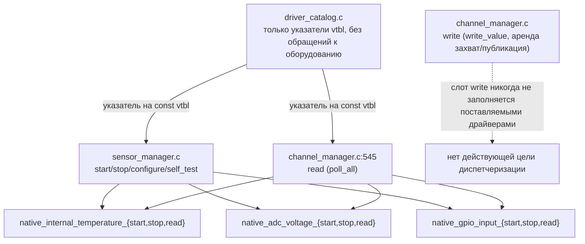
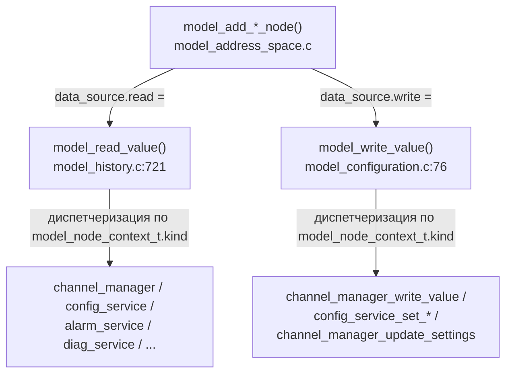
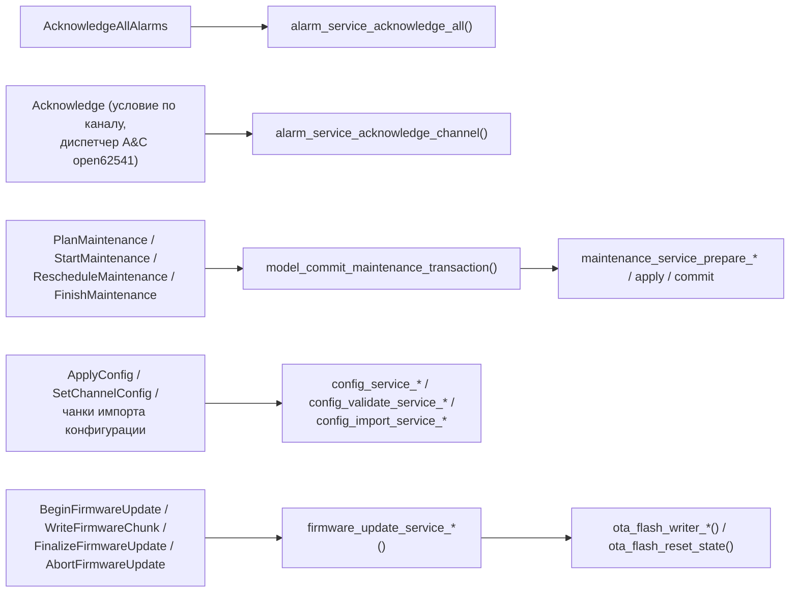
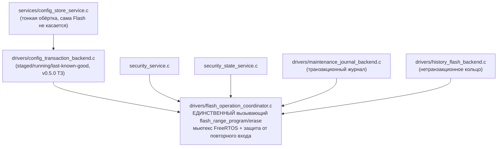
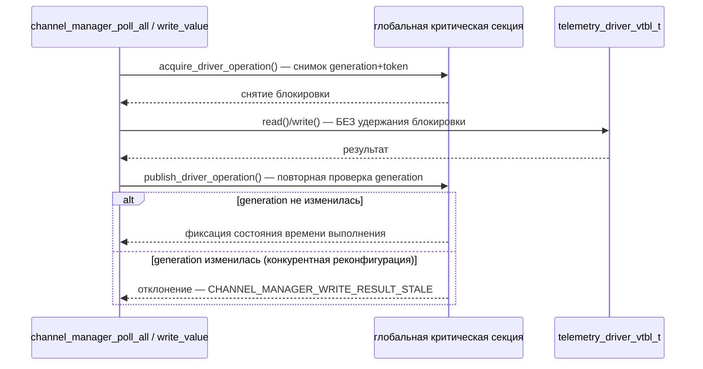

# Графы вызовов

Сфокусированные, подтверждённые доказательствами диаграммы вместо одного
огромного графа. Для исследования зависимостей на уровне файлов
используйте интерактивный граф, полученный на основе регулярных выражений,
`docs/code/topology/TOPOLOGY.html` (откройте в браузере) — он охватывает
168 файлов `.c`/`.h` первой стороны и 147 целей CMake, но является
**извлечением на основе эвристики, а не подтверждённым графом вызовов**;
см. встроенное поле `observations` для оговорок об извлечении (он не видит
диспетчеризацию через указатели на функции/vtable и может неверно
атрибутировать одноимённые функции из разных файлов). Диаграммы ниже —
проверенное подмножество, вручную подтверждённое по исходному коду в ходе
прохода картирования шестью агентами.

## Диспетчеризация драйверов (`telemetry_driver_vtbl_t`)

Слоты vtbl `configure`/`self_test`/`write` диспетчеризуются из
`sensor_manager.c`, но всегда равны NULL для трёх поставляемых драйверов —
это действующие точки диспетчеризации без текущей конкретной реализации,
до которой можно было бы дойти.

## Обобщённая диспетчеризация OPC UA

Один обобщённый коллбэк Read и один обобщённый коллбэк Write обслуживают
почти каждый узел в адресном пространстве — полную последовательность
запроса см. в [opcua-flow.md](opcua-flow.md).

## Делегирование коллбэков методов сервисам (репрезентативная выборка)

Каждый коллбэк метода, прослеженный за шесть проходов картирования,
завершается ровно одним вызовом сервиса — прямых изменений состояния
внутри `opcua_model` не обнаружено. См.
[modules/opcua_model.md](modules/opcua_model.md#method-callbacks--representative-traces)
для ссылок на источники и
[ota-bootloader.md](ota-bootloader.md#opc-ua-trigger-chain) для полной цепочки
методов OTA.

## Сериализация записи во Flash

Шесть независимых механизмов сохранения состояния более высокого уровня,
одна общая точка сериализации. См.
[hardware.md](hardware.md#flash-driver-layer) и [persistence.md](persistence.md).

## Паттерн аренды чтения/записи канала

## Связанная документация

- [modules/opcua_model.md](modules/opcua_model.md), [modules/services.md](modules/services.md),
  [modules/drivers.md](modules/drivers.md) — полные детали по каждому модулю.
- [runtime-flows.md](runtime-flows.md) — сквозные трассировки потоков.
- `docs/code/topology/topology.json` / `TOPOLOGY.html` — граф на уровне файлов,
  сгенерированный автоматически.
