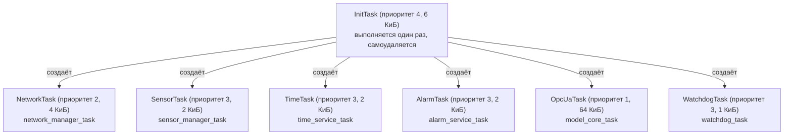

# Карта задач FreeRTOS и параллелизма

Каждая точка вызова `xTaskCreate*` первого уровня (собственного кода) в
репозитории (подтверждено сквозным grep по репозиторию, исключая
`libraries/`, `port/` и `build*/`) находится в
[app/basic_profile/main.c](../../app/basic_profile/main.c). Есть ровно одно
совпадение вне этого модуля — в `examples/opc_dhcp/w5x00_opc_dhcp.c`,
защищённое флагом `BUILD_LEGACY_EXAMPLES=OFF` (по умолчанию) и не входящее в
поставляемую прошивку. **Нигде в собственном коде не используется
`xTaskCreateStatic`.**

## Таблица задач

| Задача | Место создания | Функция входа | Приоритет | Стек | Условие |
| --- | --- | --- | --- | --- | --- |
| `InitTask` | `main.c:609-614` | `app_init_task` — `main.c:432` | 4 | 6 КиБ | всегда |
| `NetworkTask` | `main.c:546` | `network_manager_task` — `services/src/network_manager.c:224` | 2 | 4 КиБ | всегда |
| `SensorTask` | `main.c:550` | `sensor_manager_task` — `services/src/sensor_manager.c:394` | 3 | 2 КиБ | только если `channel_manager_count() > 0` (`main.c:548-551`) |
| `TimeTask` | `main.c:553` | `time_service_task` — `services/src/time_service.c:92` | 3 | 2 КиБ | всегда |
| `AlarmTask` | `main.c:554` | `alarm_service_task` — `services/src/alarm_service.c:408` | 3 | 2 КиБ | всегда |
| `OpcUaTask` | `main.c:556` | `opcua_model_task` (`opcua_model/src/opcua_model.c:9`) → `model_core_task` (`opcua_model/src/model_core_lifecycle.c:618`) | 1 | 64 КиБ | только когда `W5X00_DIAGNOSTIC_NO_OPCUA` не определён |
| `WatchdogTask` | `main.c:561-566` | `watchdog_task` — `main.c:416` | 3 | 1 КиБ | только если `watchdog_driver_is_enabled()` (`main.c:559-575`) |

`InitTask` самоудаляется (`vTaskDelete(NULL)`, `main.c:579`) после завершения
своей последовательности (см. [startup-flow.md](startup-flow.md)); остальные
шесть задач работают всё время жизни устройства.

Константы приоритетов/стеков: `main.c:45-65`. Создание задач (кроме
`WatchdogTask`/`InitTask`, которые вызывают `xTaskCreate` напрямую) идёт
через локальный вспомогательный `create_task(...)` (`main.c:291-314`),
который также регистрирует хендл через `diag_service_register_task()`
(`main.c:307`).

## Тела циклов задач

| Задача | Механизм цикла | Тело |
| --- | --- | --- |
| `NetworkTask` | `vTaskDelayUntil`, 10 мс | `w5x00_ethernet_driver_poll(&g_driver)` **вызывается напрямую из задачи сервиса** (`network_manager.c:234`), затем `network_manager_update_status()` (`:235`) |
| `SensorTask` | `vTaskDelayUntil`, период из `sensor_manager_resolve_poll_period_ms()` | повторно активирует конфигурацию при изменении ревизии (`sensor_manager.c:401-404`), `channel_manager_poll_all()` (`:407`), `sensor_manager_record_channel_history()` (`:408`) |
| `TimeTask` | `vTaskDelayUntil`, 1000 мс | читает/пишет состояние, запускает SNTP после `network_manager_is_ready()` (`time_service.c:103-108`), читает RTC (`:110-111`), выводит флаг качества (`:114-125`) |
| `AlarmTask` | `vTaskDelayUntil`, 500 мс | `alarm_service_evaluate_all()` (`alarm_service.c:417`) → перебирает снимки каналов, `alarm_service_evaluate_channel()` для каждого канала |
| `OpcUaTask` | `while(1)`, `UA_Server_run_iterate` + ограниченная задержка `vTaskDelay` 10-100 мс | см. [opcua-flow.md](opcua-flow.md) |
| `WatchdogTask` | `vTaskDelay`, ~половина таймаута или нижний предел 1000 мс | `watchdog_driver_kick()` (`main.c:426`), если установлен `g_watchdog_kick_enabled` |

**Наблюдение**: `network_manager_task` (в `services/`) вызывает функцию
опроса драйвера W5500 напрямую (`w5x00_ethernet_driver.c`, функция
`w5x00_ethernet_driver_poll`), минуя промежуточную абстракцию. Это вызов
сервисом публичного API драйвера — предусмотренное направление
`drivers -> services`, а не нарушение правила
[AGENTS.md](../../AGENTS.md) "сервисы не должны напрямую работать с
оборудованием" (сам доступ к периферии остаётся внутри `drivers/`,
[hardware.md](hardware.md)) — отмечено здесь только потому, что
поверхностный grep по вызовам с именами драйверов внутри `services/` иначе
выглядел бы подозрительно.

## Наблюдение по схеме приоритетов

`OpcUaTask` — с большим отрывом самый большой стек (64 КиБ) и задача,
владеющая стеком протокола open62541 — выполняется с **самым низким**
прикладным приоритетом (1). `NetworkTask` (цикл опроса Ethernet) —
следующий по приоритету снизу (2). `SensorTask`/`TimeTask`/`AlarmTask`/
`WatchdogTask` делят приоритет 3. `InitTask` имеет наивысший приоритет (4),
но выполняется лишь непродолжительное время при загрузке. Приведено как
архитектурное наблюдение, корректность в рамках этой документации не
оценивается.

## Примитивы синхронизации (перекрёстные ссылки на другие слои)

Этот документ описывает топологию задач; мьютексы/критические секции,
которые затрагивает каждая задача, задокументированы рядом с состоянием,
которое они защищают:

- Мьютекс FreeRTOS `flash_operation_coordinator`, сериализующий все вызовы
  стирания/программирования Flash — [hardware.md](hardware.md#flash-driver-layer).
- Критические секции кольцевого буфера истории по каналам (ограниченные по
  фрагменту, никогда не блокирующие весь скан целиком) —
  [persistence.md](persistence.md) и
  [docs/known_limits.md](../known_limits.md).
- Блокировки реестра каналов / промежуточного хранения конфигурации —
  [modules/services.md](modules/services.md).

## Связанная документация

- [startup-flow.md](startup-flow.md) — как эти задачи создаются.
- [state-ownership.md](state-ownership.md) — глобальное/статическое
  состояние, которое читает или пишет каждая задача.
- [opcua-flow.md](opcua-flow.md) — внутренний жизненный цикл сервера
  `OpcUaTask`.
