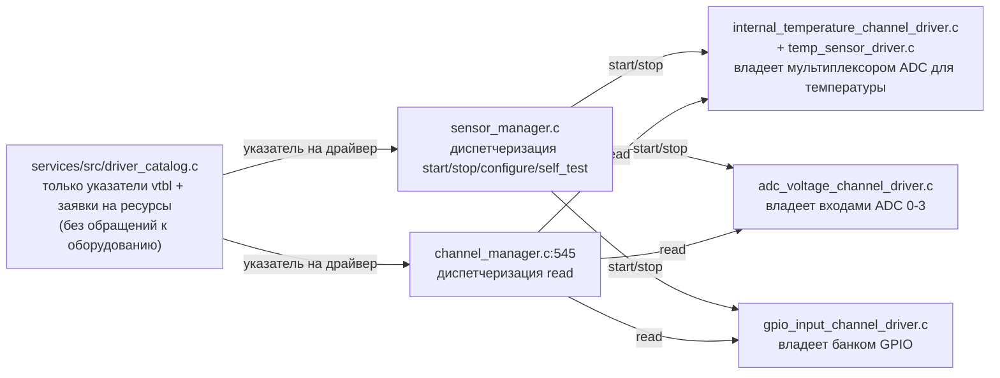
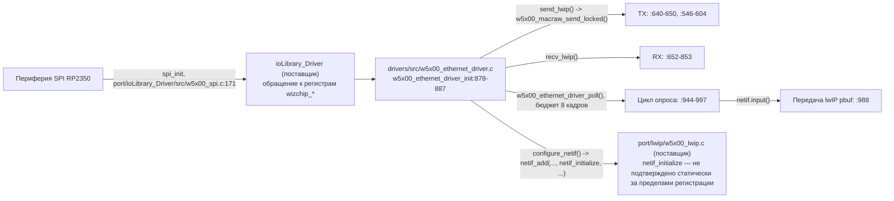
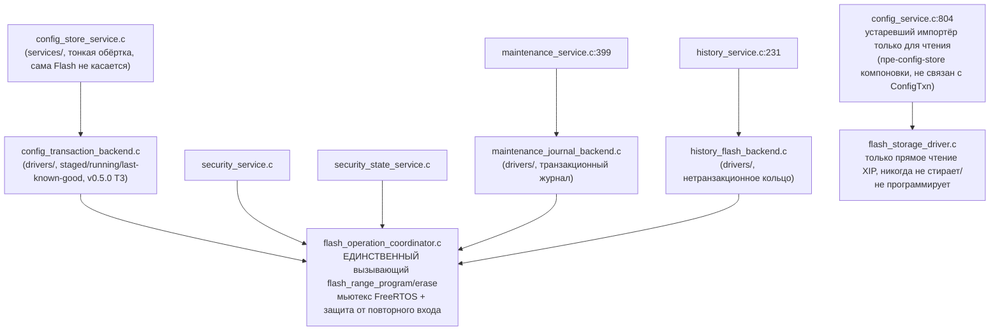

# Владение оборудованием

`drivers/` владеет каждой единицей периферии RP2350, к которой обращается
код первой стороны. Согласно [AGENTS.md](../../AGENTS.md): «Код в `services/`
не должен напрямую настраивать ADC, GPIO, SPI, I2C, Flash или другую
периферию, либо обращаться к ней». Этот документ фиксирует, что фактически
реализует эту границу, и подтверждает, соблюдается ли она сегодня.

## Таблица операций драйвера (`telemetry_driver_vtbl_t`)

Определена в
[services/include/services/telemetry_driver.h:30-39](../../services/include/services/telemetry_driver.h)
(это *контракт* уровня сервисов, а не код оборудования):

```c
typedef struct telemetry_driver_vtbl {
    telemetry_driver_result_t (*start)(telemetry_channel_t *channel);
    telemetry_driver_result_t (*stop)(telemetry_channel_t *channel);
    telemetry_driver_result_t (*read)(telemetry_channel_t *channel, uint32_t now_ms);
    telemetry_driver_result_t (*write)(telemetry_channel_t *channel, const telemetry_channel_value_t *value);
    telemetry_driver_result_t (*configure)(telemetry_channel_t *channel, const void *config);
    telemetry_driver_result_t (*self_test)(telemetry_channel_t *channel);
} telemetry_driver_vtbl_t;
```

Заполнены все слоты. `start`/`stop`/`read` — по всему набору драйверов;
`write` — в `gpio_output`/`AD5422`/`IPS2050`; `configure` — в
`gpio_output`; `self_test` — в `gpio_output`/`ADS8688`/`MAX22190`/
`IPS2050` (v0.5.1; у `AD5422` его нет — на плате ни один `SDO` ЦАП не
заведён на `BOARD_SPI_MISO`). Любой слот по-прежнему может быть NULL у
конкретного драйвера, и `sensor_manager.c` диспетчеризует за проверкой на
NULL. Трёхзначную конвенцию результата `self_test` (ответил и прошёл /
не ответил вовсе / ответил и не прошёл) см. в
`services/include/services/telemetry_driver.h`.



## Нативные драйверы каналов

| Драйвер | Файл(ы) | Владеемое оборудование | Валидность источника |
| --- | --- | --- | --- |
| Внутренняя температура | `drivers/src/internal_temperature_channel_driver.c` + `temp_sensor_driver.c` | Встроенный датчик температуры RP2350 через ADC (`adc_init`, `adc_set_temp_sensor_enabled`, `adc_select_input`, `adc_read` — `temp_sensor_driver.c:7-30`) | `source_index==0 && source_flags==0` |
| Напряжение ADC | `drivers/src/adc_voltage_channel_driver.c` | Периферия ADC, внешние аналоговые выводы 0-3 (`adc_gpio_init`, `adc_select_input`, `adc_read`) | `source_index<=3 && source_flags==0` |
| Вход GPIO | `drivers/src/gpio_input_channel_driver.c` | Банк GPIO (`gpio_init`, `gpio_set_dir`, `gpio_pull_up/down`, `gpio_get`) | `source_index < NUM_BANK0_GPIOS`, допустимые биты флагов, не pull-up и pull-down одновременно |

Таблица выше охватывает только три дженерик-драйвера, существовавших до
v0.5.1; промышленный набор (`ADS8688`, `AD5422`, `MAX22190`, `IPS2050`,
`UIC`, `synthetic`) добавлен в v0.5.1 и здесь не описан — см.
`docs/releases/v0.5.1.md`. Ни один из этих трёх не реализует
`configure`/`write`/`self_test`. Драйвер
напряжения ADC разделяет один файл-статический флаг инициализации
`g_adc_ready` между всеми экземплярами каналов напряжения ADC, отражая тот
факт, что сама периферия ADC — единый разделяемый ресурс (см. заявки на
ресурсы ниже).

## Прочие драйверы первой стороны (без vtbl — не драйверы каналов)

| Драйвер | Владеет | API |
| --- | --- | --- |
| Светодиод | одним выводом GPIO на выход | `led_driver_init/set/toggle/is_initialized` |
| Платформенные часы | системными/периферийными часами (только RP2040 — явный no-op на RP2350, чтобы не нарушить перечисление USB, `platform_clock.c:21-25`) | `platform_clock_init()` |
| RTC | таймером Always-On RP2350 (`pico/aon_timer.h`) | `rtc_driver_init/is_valid/set_unix_time/get_unix_time[_us]` |
| Watchdog | аппаратным сторожевым таймером RP2350, ограничен максимумом 16000 мс | `watchdog_driver_init/kick/is_enabled/get_timeout_ms` |

<a id="w5500--spi--networking-chain"></a>
## Цепочка W5500 / SPI / сеть



`w5x00_ethernet_driver_poll()` вызывается напрямую из `NetworkTask`
(`services/src/network_manager.c:224-240`, см. [freertos.md](freertos.md)) —
это вызов публичного API драйвера из задачи сервиса, что является
предусмотренным направлением, а не нарушением.

<a id="flash-driver-layer"></a>
## Уровень драйвера Flash

`drivers/src/flash_operation_coordinator.c` — **единственное** место в
репозитории, где напрямую вызываются `flash_range_program`/`flash_range_erase`
(`:41-51`), внутри `flash_safe_execute()` из `pico_flash`, под мьютексом
FreeRTOS, который также обнаруживает повторный вход из той же задачи
(`g_flash_operation_mutex`, `:22-24,65-91,73-75`). Публичный API:
`flash_operation_coordinator_init()`, `flash_operation_erase_sector()`,
`flash_operation_program_page()` — последняя отклоняет любую страницу,
пересекающуюся с исполняемым образом прошивки
(`flash_operation_source_is_executable_flash`).



`maintenance_journal_backend.c` и `history_flash_backend.c` сами являются
драйверами, предоставляющими своим вызывающим сторонам в `services/`
абстракцию более высокого уровня, специфичную для бэкенда (на уровне
записи журнала или сэмпла истории) — см. [persistence.md](persistence.md) для
форматов записей и [ota-bootloader.md](ota-bootloader.md) для раскладки
областей Flash, которые они занимают.

## Владение ресурсами / обнаружение конфликтов

Находится на уровне **services** (`driver_catalog`) как чистый учёт — без
обращений к оборудованию:

- Типы заявок: `DRIVER_CATALOG_RESOURCE_{NONE,ADC_INPUT,ADC_PERIPHERAL,GPIO}`
  ([services/include/services/driver_catalog.h:23-27](../../services/include/services/driver_catalog.h)).
- `driver_catalog_get_resource_claims()` (`services/src/driver_catalog.c:161-212`):
  внутренняя температура → разделяемая `ADC_PERIPHERAL`; напряжение ADC →
  эксклюзивная `ADC_INPUT` по `source_index` + разделяемая `ADC_PERIPHERAL`;
  вход GPIO → эксклюзивная `GPIO` по `source_index`.
- `driver_catalog_claims_are_compatible()` (`:214-234`) — попарная проверка
  конфликтов за O(n²), отклоняющая две заявки с одинаковыми `{type, index}`,
  если только обе не помечены как `shared`.
- Вызывается во время конфигурации (не на горячем пути времени выполнения)
  из `sensor_manager_prepare_candidate()` (`sensor_manager.c:100-108,138`) и
  независимо из `config_validate_service.c:1161-1199`.

Для шины SPI W5500, RTC/AON-таймера, watchdog или GPIO светодиода
обнаружение конфликтов отсутствует — каждый из них является драйвером-
синглтоном без выбора источника на этапе конфигурации, поэтому механизм
заявок к ним не применяется.

## Проверка нарушений разделения на уровни: результат

**Обращений к оборудованию в `services/` сегодня не обнаружено.**
Историческое нарушение в `services/driver_catalog.c`, отмеченное в более
ранних версиях `ROADMAP.md`, устранено: файл содержит только указатели
vtbl и метаданные, без включений `hardware/*.h`. Поиск по всему `services/`
по шаблону `gpio_|adc_|spi_|i2c_|flash_range_|wizchip_` находит только
строки с именами драйверов и идентификаторы указателей на функции
`native_*`, никогда — обращение к периферии. Все записи/стирания Flash из
`services/` проходят через `flash_operation_erase_sector`/
`flash_operation_program_page`, никогда напрямую через `flash_range_*`.

## Связанная документация

- [modules/drivers.md](modules/drivers.md) — полный справочник по модулю драйверов.
- [persistence.md](persistence.md) — форматы записей во Flash поверх
  необработанного уровня драйвера.
- [freertos.md](freertos.md) — какие задачи обращаются к этим драйверам.
