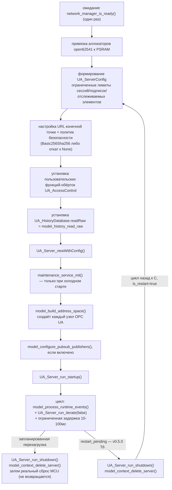

# Модуль: `opcua_model/`

## Назначение

Слой информационной модели OPC UA, построенный на open62541: жизненный
цикл сервера, построение адресного пространства, обобщённая
диспетчеризация Read/Write, коллбэки методов, Alarms & Conditions,
HistoryRead, контроль доступа и публикация PubSub/MQTT. Согласно
[AGENTS.md](../../../AGENTS.md), этот слой должен быть **адаптером** над
состоянием, принадлежащим сервисам, а не владельцем бизнес-логики.

## Главный вывод: разделение на файлы, а не на API

Целью дорожной карты `v0.4.0` было разбить монолитный `opcua_model.c` на
сфокусированные модули с централизованными константами NodeId и
централизованным отображением контроля доступа. Фактически существует
**разделение на уровне файлов с одним общим плоским внутренним
заголовком**: `opcua_model_internal.h` (1194 строки) объявляет примерно
400 прототипов функций и единую структуру `opcua_model_context_t`; каждый
файл `.c` включает его и может напрямую вызывать функции любого другого
модуля. Публичного заголовка для каждого модуля не существует, поэтому
граница «модуля» — это граница единицы трансляции, а не граница API.

Несколько имён файлов не отражают их фактическое содержимое:

| Файл | Название предполагает | Фактически содержит |
| --- | --- | --- |
| `model_channels.c` | Создание объектов каналов | Сравнение config-diff/необходимости перезагрузки, вспомогательные функции для истечения срока сертификатов/доверия, функции доступа к фиксированным NodeId, построители строк тем PubSub |
| `model_address_space.c` | (обобщённое) | **Именно здесь фактически находится создание узлов модели каналов и диагностики** — `model_add_channel_nodes`, оркестратор `model_build_address_space`, ~70 функций регистрации узлов-методов |
| `model_diagnostics.c` | Узлы диагностики | Методы управления пользователями `SetRole`/`DisableUser`/`DeleteUser` и обобщённые вспомогательные функции построения узлов; узлы диагностики находятся в `model_address_space.c:2622-2798` |
| `model_ota.c` | OTA | В основном методы импорта конфигурации/доверия/конфигурации каналов; методы OTA составляют меньшинство файла |
| `model_maintenance.c` (2839 строк, самый большой файл) | Обслуживание | Объединяет условия DeviceHealth/SecurityFault, генерацию событий общего назначения, постановку в очередь событий аудита, опрос истечения срока сертификатов **и** методы рабочего процесса обслуживания |

Движок тревог по каналам версии v0.4.3 находится в `model_events.c`, а не
в `model_maintenance.c`. Строки путей NodeId разбросаны по трём местам
(`#define` в `opcua_model_internal.h:539-654`, встроенные литералы
`UA_NODEID_STRING` в `model_address_space.c` и функции доступа в
`model_channels.c:349-415`) — единого `model_nodeids.c` не существует.
**Это приводится как информационный вывод для инженерной документации, не
исправляется в рамках данного прохода.**

## Опись файлов

| Файл | Строк | Ответственность (проверено) |
| --- | --- | --- |
| `opcua_model.c` | 12 | Обёртка публичного API: перенаправляет вызовы в `model_core_init`/`model_core_task` |
| `opcua_model_context.c` | 122 | Владеет `g_model_context`, единственным экземпляром контекста со статическим временем жизни |
| `model_core_lifecycle.c` | 1023 | Жизненный цикл сервера — см. §Жизненный цикл сервера |
| `model_common.c` | 276 | Сквозные утилиты: адаптер логгера UA, вспомогательные функции сессии |
| `model_access.c` | 1087 | Плагин контроля доступа + вспомогательные функции сессии/роли — см. §Контроль доступа |
| `model_address_space.c` | 3631 | Построитель адресного пространства: модель каналов, диагностика, DI/AMB, создание узлов сети/времени/безопасности/конфигурации/обмена сообщениями, оркестратор |
| `model_channels.c` | 697 | Функции доступа к NodeId, вспомогательные функции config-diff, построители тем PubSub (см. оговорку об именовании выше) |
| `model_configuration.c` | 1166 | Обобщённая диспетчеризация DataSource **Write** + коллбэки методов конфигурации/идентификации/перезагрузки |
| `model_security.c` | 820 | Методы жизненного цикла сертификатов/идентичности/списка доверия |
| `model_ota.c` | 1319 | Импорт конфигурации/доверия, методы обновления прошивки (OTA), методы конфигурации каналов, управление пользователями |
| `model_diagnostics.c` | 390 | Методы управления пользователями, обобщённые вспомогательные функции построения узлов (см. оговорку об именовании), поддерево `Device.Compatibility` (v0.5.0 T8) |
| `model_identity_di_amb.c` | 660 | Дерево локаций AMB, функциональные группы DI, поиск псевдонимов активов |
| `model_events.c` | 1423 | Инфраструктура Events/Conditions + **движок тревог по каналам v0.4.3** |
| `model_maintenance.c` | 2839 | Условия DeviceHealth/SecurityFault, генерация событий, аудит, опрос истечения срока сертификатов, методы рабочего процесса обслуживания |
| `model_history.c` | 1403 | Обобщённая диспетчеризация DataSource **Read** + **бэкенд HistoryRead** |
| `model_pubsub.c` | 592 | Конфигурация издателей PubSub/MQTT и состояние времени выполнения |

## Жизненный цикл сервера

`opcua_model_init()` → `model_core_init()` выделяет ограниченную временную
память в PSRAM (полезная нагрузка экспорта обслуживания, буфер сэмплов
чтения истории). Сам сервер выполняется в `OpcUaTask` →
`model_core_task()` (`model_core_lifecycle.c:618-1002`):

**Управляемый перезапуск сервера OPC UA (v0.5.0 T6)**: `config_service_run_commit_extensions()`
после каждой успешно зафиксированной транзакции конфигурации безусловно
вызывает коллбэк, зарегистрированный через
`config_service_set_restart_callback()` —
`model_config_service_restart_callback` (`model_core_lifecycle.c`). Этот
коллбэк вызывает `model_config_requires_server_reboot()` и, если требуется
перестроение адресного пространства, устанавливает
`g_pending_actions.restart_pending`, а не перестраивает `UA_Server`
напрямую: этот коллбэк выполняется изнутри вызова метода OPC UA, то есть
уже вложен в тот самый вызов `UA_Server_run_iterate()`, которому
принадлежит указатель `server` — удаление сервера прямо здесь освободило бы
память, которую этот внешний кадр вызова ещё использует после возврата
коллбэка (например, `model_apply_config` разыменовывает `server` снова
сразу после `config_service_apply()`, вызывая
`model_refresh_amb_locations`). Цикл `model_core_task` замечает флаг сразу
после возврата текущего вызова `UA_Server_run_iterate()` — раньше, чем
может быть обслужен любой следующий запрос клиента — корректно завершает
работу старого сервера и строит новый **тем же самым кодом**, что и
холодный старт (`for (;;)` в `model_core_task`), никогда не второй,
параллельной реализацией. Транзакция, не требующая перестроения
(`model_config_requires_server_reboot()` вернул false), никогда не
устанавливает флаг — работающий сервер, его сессии и подписки остаются
полностью нетронутыми.

Видимая клиентам последовательность при перезапуске: все существующие
сессии/подписки теряются (то же поведение переподключения, что и при полной
перезагрузке прошивки — намеренное решение, см. `docs/releases/v0.5.0.md`,
пункт 6 списка зафиксированных решений), клиент должен переподключиться;
после переподключения он видит адресное пространство новой конфигурации.

**Порядок с очисткой истории/тревог по каналу (v0.5.0 T7)**: перед вызовом
коллбэка перезапуска `config_service_run_commit_extensions()`
(`services/src/config_service.c:210-225`) синхронно вызывает
`config_service_clear_stale_channel_state()`, которая для каждого
удалённого или изменённого (тот же `channel_id`, другой `driver_id`/
`value_type`) канала очищает его историю (`history_service_clear_channel()`)
и состояние условия тревоги (`alarm_service_clear_channel()`) — раньше, чем
может сработать перезапуск, зарегистрированный ниже. Тот факт, что любое
такое изменение канала всегда взводит
`model_config_requires_server_reboot()`, гарантирует: ни один клиент
никогда не увидит пространство имён, всё ещё содержащее канал, чьё
состояние истории/тревог уже очищено.

Загрузка NodeSet (DI/AMB) происходит внутри поставляемой сборки open62541
через `port/open62541/nodesetinjector.c` до возврата из
`UA_Server_newWithConfig` — `opcua_model` лишь *потребляет* уже
внедрённые пространства имён по имени (`UA_Server_getNamespaceByName`).
Пространство имён каналов, напротив, действительно принадлежит
`opcua_model`: `UA_Server_addNamespace(server, MODEL_CHANNEL_NAMESPACE_URI)`.

## Обобщённая диспетчеризация Read/Write

`UA_DataSource` каждого переменного узла подключает одни и те же две
функции: `model_read_value` (`model_history.c:721`) и `model_write_value`
(`model_configuration.c:76`), каждая из которых диспетчеризует по
`model_node_context_t.kind`. `model_write_value` проверяет
анонимность/роль доступа, затем **делегирует каждое изменение вызову
сервиса** — `channel_manager_write_value`, `config_service_set_asset_id`,
`channel_manager_update_settings`,
`config_service_set_timezone_offset_minutes`. Прямого изменения полей
состояния, принадлежащего сервису, не обнаружено.

## Генерация модели каналов

`model_build_address_space` итерирует реестр каналов через
`channel_manager_copy_snapshot_by_index` (ограниченно, на основе снимков —
никогда сырым указателем). `model_add_channel_nodes` использует
фиксированный стековый массив для всех строк node-id (без выделения из
кучи); при любом сбое удаляются только уже созданные для этого канала
узлы. Вызывающий код дополнительно вызывает `model_rollback_channel_model`
при сбое, который детерминированно проходит и удаляет каждый узел
канала/устаревший узел, который ещё может разрешить, по всем слотам
`PLATFORM_CHANNEL_LIMIT` — удовлетворяя требованию v0.4.2 «ограниченное
временное выделение памяти и детерминированный откат».

## Alarms & Conditions и HistoryRead

**Тревоги по каналам (v0.4.3)**: `model_build_channel_alarm_conditions`
(`model_events.c:1079`) создаёт один экземпляр `ChannelAlarmConditionType`
для каждого канала, допускающего тревоги, используя
`alarm_service_value_type_is_eligible` как предикат допустимости,
принадлежащий сервису. `model_process_channel_alarm_conditions`
выполняется на каждой итерации цикла и **только транслирует** уже
вычисленное состояние `alarm_condition_status_t` в
`ActiveState`/`Severity`/`Quality` — оценка порогов на уровне модели не
выполняется. Подтверждение (Acknowledge) идёт в обратном направлении через
`model_channel_alarm_acked_callback` → `alarm_service_acknowledge_channel`.
Условия DeviceHealth/SecurityFault — отдельная, более старая подсистема в
`model_maintenance.c`.

**HistoryRead**: `config->historyDatabase.readRaw = model_history_read_raw`
разрешает запрашиваемый NodeId в идентификатор канала, аннулирует
устаревшие точки продолжения (16 слотов, TTL 30 с), ограничивает
`numValuesPerNode` значением `HISTORY_SERVICE_MAX_RETURN_COUNT` и вызывает
`history_service_read_channel_samples()` — слой модели никогда не
обращается к самому кольцевому буферу напрямую. См.
[docs/channel_model.md](../../channel_model.md#history-v043).

## Совместимость и пресеты конфигурации (v0.5.0 T8)

`model_build_compatibility_info` (`model_diagnostics.c:435-540`) строит
поддерево `Device.Compatibility` как обычный статический
организованный объект (без диспетчеризации DataSource — значения читаются
один раз при построении адресного пространства, не за счёт коллбэка):

| BrowseName | Тип | Источник |
| --- | --- | --- |
| `Device.Compatibility.FirmwareProfile` | `String` | Компилируемая идентичность драйвер-пака (`ROADMAP.md` 5.1), отдельно от рантайм-пресета конфигурации |
| `Device.Compatibility.HardwareRevision` | `String` | `device_profile_config_t::hw_revision` |
| `Device.Compatibility.ConfigurationSchemaVersion` | `UInt32` | `CONFIG_STORE_SCHEMA_VERSION_CURRENT` (v0.5.0 T2) |
| `Device.Compatibility.SupportedDrivers.<name>` | `String` (JSON) | По одному статическому узлу на запись `driver_catalog` — цикл по `driver_catalog_count()`/`_get_by_index()`, так что поддерево всегда отражает фактически скомпилированный каталог драйверов, а не жёстко заданное число |

Рантайм-пресеты конфигурации (`services/config_presets.c`, отдельно от
пресета `FirmwareProfile` выше) экспонируются двумя методами
`Device.Maintenance` (`model_address_space.c:972-1000`):
`ListConfigPresets` возвращает каталог пресетов времени компиляции в виде
JSON; `ApplyConfigPreset` принимает имя одного из пресетов (`"sensor_node"`,
`"remote_io"` или `"dev_benchmark"`) и разрешает/применяет его через
`config_presets_apply()` — тот же самый конвейер транзакции
validate→persist-staged→stop→activate→verify→commit/rollback, что и любая
другая кандидатная конфигурация; отдельного пути применения не существует.
Требуемая роль для `ApplyConfigPreset` — `SECURITY_ROLE_OPERATOR`
(`model_access.c:409-415`, префиксное совпадение с
`"Device.Maintenance.ApplyConfig"`, та же роль, что и у существующего
`ApplyConfig`).

## Контроль доступа

Обеспечивается на уровне плагина open62541 `UA_AccessControl`:
`model_core_task` сохраняет коллбэки по умолчанию, затем устанавливает
функции-обёртки (`model_access.c`), которые вызывают исходные функции по
цепочке и дополнительно применяют проверки роли. Отображение роль-метод и
роль-тип узла централизовано в `model_required_role_for_method` и
`model_required_role_for_write_kind` — это единственное место, где цель
дорожной карты «централизовать отображение политики контроля доступа»
полностью выполнена. Обобщённые коллбэки Read/Write повторно проверяют
роль во второй раз перед обращением к любому сервису (эшелонированная
защита).

## PubSub/MQTT и диагностика

`model_pubsub.c` формирует **и хранит** состояние времени выполнения
PubSub (`model_pubsub_runtime_t` внутри `opcua_model_context_t`) —
состояние адаптера/времени выполнения, принадлежащее модели, а не
бизнес-состояние, поэтому это не нарушает правило «сервисы владеют
состоянием», но означает, что этот модуль одновременно формирует и владеет
состоянием, в отличие от большей части слоя. Узлы диагностики (время
работы, куча, PSRAM, загрузка CPU, стек по каждой задаче) строятся
непосредственно в `model_address_space.c:2622-2798`, считывая состояние
`diag_service`/`psram_allocator`.

## Зависимости / Зависимые модули

- **Зависимости**: `services/` (каждый коллбэк делегирует вызов
  `*_service_*`), open62541 (`open62541_v1.5.3/`, поставляемый),
  `port/open62541/nodesetinjector.c` (внедрение NodeSet DI/AMB).
- **Зависимые модули**: `app/basic_profile/main.c` (`opcua_model_init`,
  создание задачи).

## Нарушений разделения на уровни не обнаружено

Каждый проверенный коллбэк и каждая ветвь обобщённого Write завершается
вызовом функции `*_service_*`. Единственная обнаруженная структурная
аномалия носит организационный характер (несоответствие имени файла и
содержимого, выше), а не является нарушением границы сервиса.

## Связанная документация

- [opcua-flow.md](../opcua-flow.md) — трассировки клиент → сервер → сервис
  → ответ для Read и Write.
- [state-ownership.md](../state-ownership.md) — `g_model_context` и другое
  состояние, принадлежащее модели.
- [freertos.md](../freertos.md) — `OpcUaTask`.
