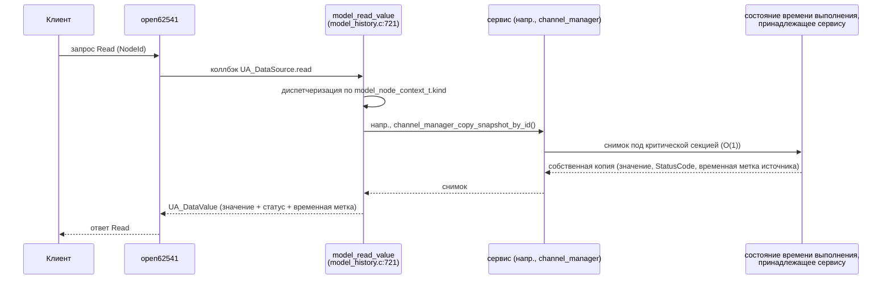
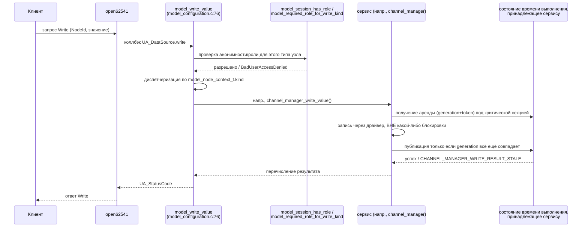
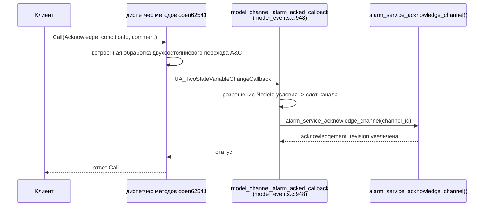

# Потоки запросов OPC UA

Прослеживает путь реализации для Read и Write, от клиента до ответа, как он
реализован фактически. Оба типа запросов проходят через **одни и те же два
обобщённых коллбэка DataSource** для подавляющего большинства узлов — здесь
нет разрастания коллбэков по типам узлов. Полный жизненный цикл сервера и
опись модулей см. в [modules/opcua_model.md](modules/opcua_model.md).

## Read

Каждый переменный узел, зарегистрированный через `model_add_*_node` в
`model_address_space.c`, подключает `data_source.read = model_read_value`.
Коллбэк никогда сам не удерживает блокировку сервиса — он вызывает
функцию доступа сервиса (`channel_manager_copy_snapshot_by_id`,
`config_service_get`, `alarm_service_get_condition_by_index` и т. д.),
которая внутренне захватывает и снимает собственную блокировку, а затем
возвращает собственное значение. Отображение качества
(`GOOD`/`UNCERTAIN`/`BAD`→`BadNotConnected`) и преобразование временной
метки источника следуют
[docs/channel_model.md](../channel_model.md#quality-timestamp-and-writes).

## Write

`model_write_value` — чистый адаптер для каждой найденной ветви
диспетчеризации: `channel_manager_write_value` (значения каналов),
`config_service_set_asset_id`, `channel_manager_update_settings` (период
выборки/публикации, смещение/масштаб, пороги тревог),
`config_service_set_timezone_offset_minutes`. Прямого изменения полей
состояния, принадлежащего сервису, в этой функции не обнаружено.

Авторизация проверяется **дважды**: один раз на уровне плагина
`UA_AccessControl` (`model_get_user_access_level_wrapper`,
[modules/opcua_model.md](modules/opcua_model.md#access-control)) ещё до того,
как open62541 вообще вызывает запись DataSource, и повторно внутри самой
`model_write_value`.

## Вызов метода OPC UA (пример: Acknowledge для тревоги канала)

Путь обобщённого узла-Method (например, `PlanMaintenance`,
`BeginFirmwareUpdate`, `AcknowledgeAllAlarms`) следует той же схеме:
`model_require_method_role()` защищает вызов, затем тело делегирует ровно
одной функции сервиса. Трассировки для конфигурации и обслуживания см. в
[runtime-flows.md](runtime-flows.md), а методы OTA — в
[ota-bootloader.md](ota-bootloader.md#opc-ua-trigger-chain).

## Связанная документация

- [modules/opcua_model.md](modules/opcua_model.md) — полная опись модуля и
  жизненный цикл сервера.
- [call-graphs.md](call-graphs.md) — диаграммы таблиц диспетчеризации.
- [freertos.md](freertos.md) — `OpcUaTask`.
