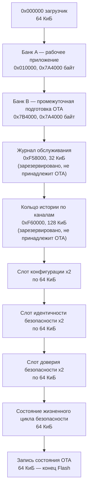
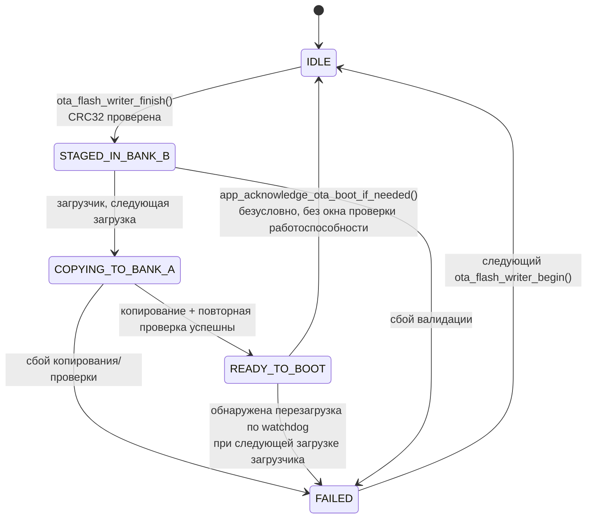
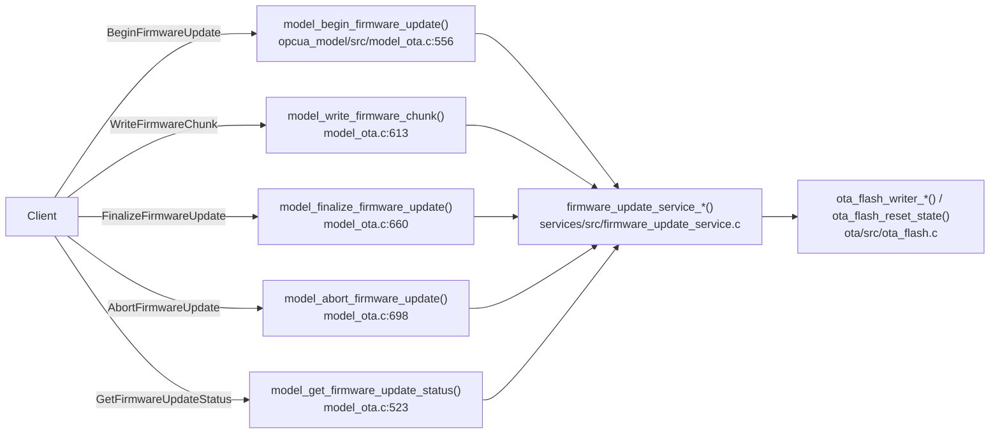
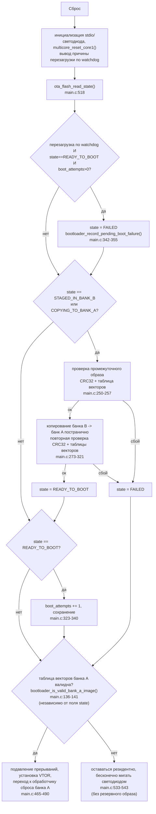
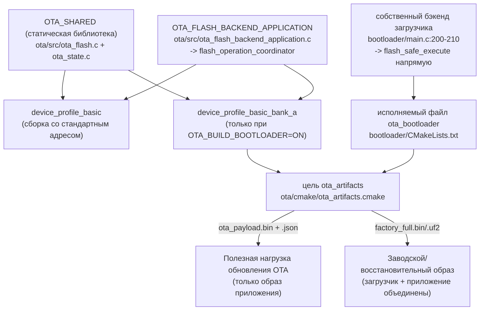

# OTA и загрузчик

Описывает **фактически реализованный** механизм обновления (базовая версия
v0.4.3), а не цель дорожной карты `v0.6.0 — Signed OTA and Recoverable
Boot`. Каждое утверждение ниже подтверждено ссылкой `path:line`; из v0.6.0
в текущем дереве ничего не реализовано.

## Раскладка Flash

Вычисляется на этапе конфигурации CMake из `PICO_FLASH_SIZE_BYTES` в
[ota/cmake/ota_layout.cmake:34-97](../../ota/cmake/ota_layout.cmake),
формируется в генерируемый заголовок (`ota/cmake/ota_layout.h.in` →
макросы `OTA_LAYOUT_*`) и генерируемые входные данные JSON-манифеста
(`ota/cmake/ota_layout.json.in`). Вся раскладка должна точно покрывать
`PICO_FLASH_SIZE_BYTES`, иначе конфигурация завершится ошибкой
(`ota_layout.cmake:90-93`); размер каждой области должен быть кратен 4 КиБ
(`ota_layout.cmake:51-59`).

Для эталонной цели `waveshare_core2350b_16mb_psram8mb` это разрешается в
Банк A `0x010000+0x7A4000`, Банк B `0x7B4000+0x7A4000`, журнал обслуживания
`0xF58000+0x8000`, история `0xF60000+0x20000`, конфигурация начинается с
`0xF80000` (сверено с [docs/flash-storage.md](../flash-storage.md)).

Размер двух банков приложения определяется путём вычитания всех
зарезервированных областей из общего объёма Flash и деления остатка ровно
пополам (`ota_layout.cmake:37-38`), с защитой через `FATAL_ERROR`, если
деление не является ровным (`:44-46`) или зарезервированные области
превышают объём Flash (`:41-43`).

**Запись состояния OTA на устройстве**
([ota/include/ota/ota_state.h:28-41](../../ota/include/ota/ota_state.h)) —
единственные постоянные метаданные OTA: защитные поля `magic`/
`format_version`, `state`, `image_size`, `image_crc32`,
`staged_bank_offset`/`staged_bank_size`, `version_number`, `boot_attempts`,
`last_error`, зарезервированные слова и завершающий `record_crc32`.
Отдельной области «манифеста» на устройстве не существует — упомянутый
ниже JSON-манифест является исключительно артефактом сборки/хоста.

Генерируемые скрипты компоновщика: `ota/cmake/ota_flash_region.ld.in`
инстанцируется один раз для банка A (приложение) и один раз для области
загрузчика, встраивается в шаблон Pico SDK `memmap_default.ld`
(`ota_layout.cmake:104-120`), производя `app_bank_a_memmap.ld` и
`bootloader_memmap.ld`, применяется через
`ota_layout_set_app_bank_a_linker_script()` /
`ota_layout_set_bootloader_linker_script()` (`ota_layout.cmake:126-132`).

## Конечный автомат состояния OTA

Перечисление состояний: [ota/include/ota/ota_state.h:11-17](../../ota/include/ota/ota_state.h).
Функции переходов (`ota/src/ota_flash.c`, если не указано иное):

| Переход | Функция | Ссылка |
| --- | --- | --- |
| любое → `IDLE` | `ota_flash_reset_state()` | `ota_flash.c:123-129`, вызывает `ota_state_reset_record()` (`ota_state.c:29-42`) |
| `IDLE` → начало промежуточной подготовки | `ota_flash_writer_begin()` | `ota_flash.c:194-220` (сброс в IDLE, стирание банка B; запись «в процессе» не создаётся) |
| (буферизация) | `ota_flash_writer_write()` | `ota_flash.c:222-262` (без перехода состояния) |
| → `STAGED_IN_BANK_B` | `ota_flash_writer_finish()` | `ota_flash.c:264-312`, проверяет CRC32, записывает `image_size`/`image_crc32`/смещение и размер банка/`version_number`/`boot_attempts=0` |
| `STAGED_IN_BANK_B`/`COPYING_TO_BANK_A` → `READY_TO_BOOT`/`FAILED` | только загрузчик | см. ниже |
| `READY_TO_BOOT` → `IDLE` | `app_acknowledge_ota_boot_if_needed()` | `app/basic_profile/main.c:274-289` |

Обёртка на уровне сервиса `services/src/firmware_update_service.c`
(`firmware_update_service_begin/write_chunk/finalize/abort/get_status`,
[services/include/services/firmware_update_service.h:38-46](../../services/include/services/firmware_update_service.h))
владеет одним глобальным флагом `session_active` плюс `ota_flash_writer_t`
(`firmware_update_service.c:7-16`), обеспечивая одну сессию одновременно
(`FIRMWARE_UPDATE_RESULT_BUSY`, `:58-62`) и максимум 4096 байт на чанк
(`FIRMWARE_UPDATE_SERVICE_MAX_CHUNK_BYTES`, `firmware_update_service.h:10`,
проверяется `:101-105`).

### Цепочка триггеров OPC UA

Каждый коллбэк вызывает `model_require_method_role()` перед обращением к
сервису (например, `model_ota.c:580-584`) — в соответствии с правилом
адаптера из [AGENTS.md](../../AGENTS.md). Имена NodeId методов
(`Device.Maintenance.Firmware`, `BeginFirmwareUpdate` и т. д.) видны из
`static/tools/stage_ota.py:28-35`; их регистрация находится в `opcua_model`.

## Последовательность загрузки загрузчика

Точка входа [bootloader/main.c:492](../../bootloader/main.c) (`int main(void)`),
собирается как исполняемый файл `ota_bootloader`
([bootloader/CMakeLists.txt:1-27](../../bootloader/CMakeLists.txt)).

Окончательное решение о загрузке зависит **только** от того, является ли
таблица векторов банка A корректной (`bootloader_is_valid_bank_a_image()`,
`main.c:136-141`, проверяет, что начальный SP находится внутри
`BOOTLOADER_RAM_START..BOOTLOADER_RAM_END`, а обработчик сброса попадает в
диапазон Flash банка A с установленным битом Thumb), **а не** от поля
`state` записи состояния OTA.

## Проверка целостности

Единственный механизм проверки целостности, применяемый **на устройстве**
— CRC-32 (`ota_crc32_compute()`, [ota/src/ota_state.c:6-27](../../ota/src/ota_state.c)):

- **Во время загрузки образа**: `ota_flash_writer_finish()` →
  `ota_flash_verify_bank_b()` (`ota_flash.c:166-182`) сравнивает с
  аргументом `expected_crc32`, **предоставленным клиентом** в
  `BeginFirmwareUpdate` (`model_ota.c:595-601`) — не выведенным независимо
  из доверенного источника.
- **Во время загрузки устройства**: `bootloader_validate_staged_image()`
  (`main.c:250-257`) повторно проверяет CRC32 банка B, а
  `bootloader_copy_bank_b_to_bank_a()` (`main.c:273-321`) повторно
  вычисляет CRC32 скопированного образа банка A и повторно проверяет
  таблицу векторов (`main.c:310-318`) перед `READY_TO_BOOT`.
- Запись состояния OTA несёт собственный `record_crc32` (`ota_state.c:44-67`)
  для обнаружения повреждённой записи состояния, а не для аутентификации
  образа.

**На устройстве не существует проверки SHA-256 или подписи.** Манифест на
стороне хоста (`ota/tools/write_ota_manifest.ps1:14`) вычисляет SHA-256, а
`static/tools/stage_ota.py:145-155` сверяет CRC32/SHA-256 с ним перед
промежуточной подготовкой — но SHA-256 никогда не передаётся на устройство
и не проверяется им; в `ota_state_record_t` попадает только 32-битный CRC.
Это соответствует `ROADMAP.md` §5.12 и является именно тем пробелом,
который призвана закрыть `v0.6.0` (пока нигде не реализовано в
`ota/`/`bootloader/`).

## Подтверждение работоспособности и откат — текущий пробел

**Подтверждение не является проверкой работоспособности.**
`app_acknowledge_ota_boot_if_needed()`
([app/basic_profile/main.c:274-289](../../app/basic_profile/main.c)),
вызываемая один раз из `app_init_task()` (`main.c:578`) сразу после
создания задач FreeRTOS и непосредственно перед самоудалением этой задачи
инициализации, безусловно сбрасывает состояние OTA в `IDLE` в момент, когда
обнаруживает `READY_TO_BOOT` (`main.c:279-288`) — без какой-либо проверки
того, что сеть, OPC UA или любая другая подсистема действительно
работоспособна. Это временная метка создания задачи, а не окно проверки
работоспособности, что дословно соответствует `ROADMAP.md` §5.12.

**Откат обнаруживает, но не может восстановить.** Если только что
скопированный образ зависает достаточно сильно, чтобы сработал аппаратный
watchdog до выполнения подтверждения, следующая загрузка загрузчика
помечает запись как `FAILED` (`bootloader_record_pending_boot_failure()`,
`main.c:342-355`). Но:

- Банк A **уже был перезаписан** во время `COPYING_TO_BANK_A` — отдельного
  «последнего заведомо исправного» банка не существует; банк B
  используется повторно исключительно как промежуточная область.
  `FAILED` останавливает цикл копирования, но ничего не восстанавливает.
- Окончательное решение о загрузке (см. диаграмму выше) по-прежнему
  зависит только от валидности таблицы векторов банка A, а не от `state`
  — структурно валидный, но неисправный образ продолжает загружаться (и
  продолжает вызывать перезагрузки по watchdog) без ограничения по числу
  попыток, поскольку `bootloader_prepare_ready_state_for_boot()`
  продолжает наращивать `boot_attempts`, пока `state` остаётся
  `READY_TO_BOOT`.

Это задокументированная цель `v0.6.0` («заменить немедленное подтверждение
окном проверки работоспособности», «сохранить загружаемый резервный образ,
чтобы сбой действительно мог откатиться») — сегодня не реализована.
**Приводится как наблюдение для будущей работы по дорожной карте, не
исправляется в рамках этого документационного прохода.**

## Цели CMake

С каждым образом линкуется ровно один бэкенд Flash: общий
`OTA_FLASH_BACKEND_APPLICATION` (проходит через
`flash_operation_coordinator`, см. [hardware.md](hardware.md)) — для
образов приложения, и собственная бесплатформенная реализация загрузчика
(`bootloader/main.c:200-210`, напрямую через `flash_safe_execute`) — для
самого загрузчика; это обеспечивается `ota/src/ota_flash_backend.h:9-13`.

`app/basic_profile/CMakeLists.txt:115-169` (`add_device_profile_target`)
производит две цели: сборку со стандартным адресом и, только если
`OTA_BUILD_BOOTLOADER` включён, `_bank_a` (линкуется на диапазон адресов
банка A через `ota_layout_set_app_bank_a_linker_script()`). Когда
существуют и `ota_bootloader`, и `..._bank_a`, `ota_artifacts.cmake`
подключает постсборочную цель `ota_artifacts`, производящую
`ota_payload.bin`/`.json` (полезная нагрузка обновления OTA — только образ
приложения) и `factory_full.bin`/`.uf2` (загрузчик + приложение,
объединённые для прошивки через USB BOOTSEL/первичной прошивки через
`picotool`).

## Инструментарий оператора: `static/tools/stage_ota.py`

Python CLI для оператора, управляющий описанным выше конечным автоматом
через аутентифицированную сессию OPC UA (`asyncua`), а не низкоуровневый
инструмент прошивки. Получив URL сервера и манифест (по умолчанию
`build/ota_artifacts/ota_payload.json`), он повторно проверяет
размер/CRC32/SHA-256 полезной нагрузки по манифесту, опционально
устанавливает `Basic256Sha256`/`SignAndEncrypt` с аутентификацией по
клиентскому сертификату, вызывает `BeginFirmwareUpdate` /
`WriteFirmwareChunk` (по умолчанию чанками по 4096 байт) /
`FinalizeFirmwareUpdate`, и может возобновить загрузку
(`--resume-active`), прервать её, только запросить статус
(`--status-only`) или инициировать перезагрузку после финализации
(`--reboot-after-finalize`). Он не выполняет прямого доступа к Flash и не
производит криптографической проверки на устройстве сверх описанной выше
сверки с манифестом.

## Связанная документация

- [docs/flash-storage.md](../flash-storage.md) — владение областями Flash
  во всех подсистемах, не только в OTA.
- [docs/known_limits.md](../known_limits.md) — размер чанка OTA и другие
  ограниченные ресурсы.
- [docs/code/hardware.md](hardware.md) — общая сериализация доступа к
  Flash через `flash_operation_coordinator`, используемая бэкендом OTA на
  стороне приложения.
- [docs/code/modules/bootloader.md](modules/bootloader.md) — подробности
  модуля загрузчика.
