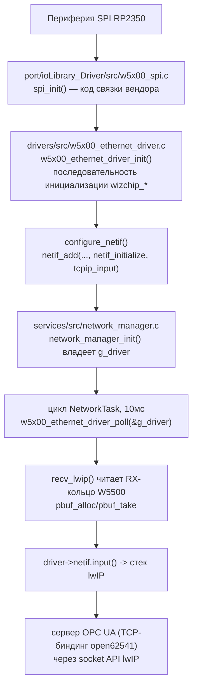
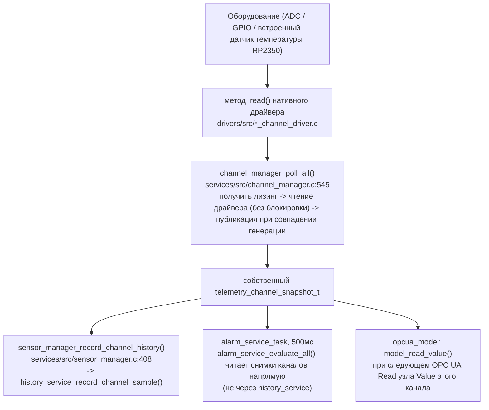
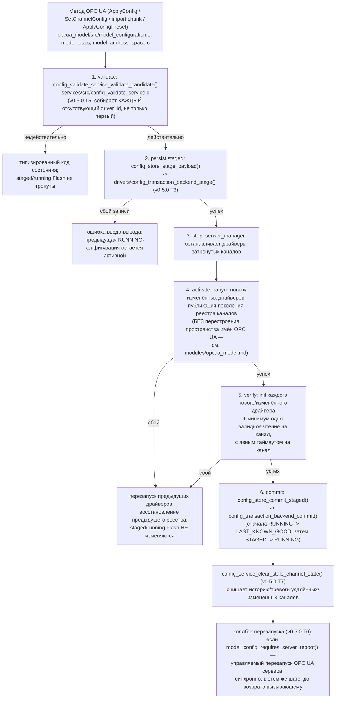
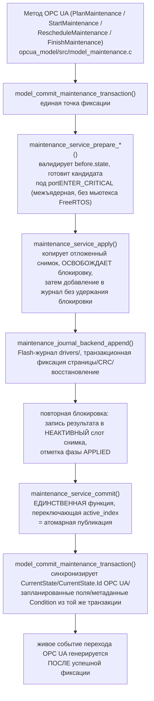

# Потоки выполнения во время работы

Прослеживает пути реализации, необходимые для инженерной документации.
Загрузка, OPC UA Read/Write и OTA имеют отдельные страницы с полными
диаграммами — ссылки приведены ниже, без дублирования. Сеть, опрос каналов,
конфигурация и техническое обслуживание прослежены здесь полностью.

## Загрузка

См. [startup-flow.md](startup-flow.md) — сброс → (загрузчик) → `main()` →
инициализация платформы → хранилище → сеть → сервисы → OPC UA →
планировщик FreeRTOS, с точной таблицей фатальных/только-логируемых ошибок
и всеми примечательными наблюдениями по порядку выполнения.

## Сеть

`NetworkTask` вызывает функцию опроса драйвера напрямую — предусмотренное
направление `services -> drivers`, а не нарушение (см.
[hardware.md](hardware.md#w5500--spi--networking-chain)). `OpcUaTask`
блокируется на `network_manager_is_ready()` перед формированием
`UA_ServerConfig` — см.
[modules/opcua_model.md](modules/opcua_model.md#server-lifecycle) — поэтому
сервер OPC UA не начинает прослушивание, пока `network_manager` не сообщит о
готовности линка и последовательности DHCP/статического IP. `TimeTask`
аналогично привязывает запуск SNTP к тому же флагу готовности.

## Опрос каналов

Управляется циклом `SensorTask` (`sensor_manager_task`,
[freertos.md](freertos.md)): `channel_manager_poll_all()`, затем
`sensor_manager_record_channel_history()`, один раз за настроенный период
выборки. `alarm_service` читает снимки каналов независимо, в собственной
задаче с периодом 500 мс, не через `history_service` — история и аварийные
сигналы являются независимыми подсистемами согласно
`docs/releases/v0.4.3.md`. Адаптер OPC UA никогда не опрашивает драйвер
напрямую; он всегда читает последний снимок, опубликованный
`channel_manager`.

## Конфигурация (v0.5.0: реальный конвейер транзакции)

С v0.5.0 `config_service_apply()`/`config_service_replace_and_save()`
выполняют единственный зафиксированный порядок — validate -> persist staged
-> stop -> activate -> verify -> commit/rollback — заменивший
pre-v0.5.0 порядок «activate before persist» (T4):

Каждый шаг выполняется синхронно и последовательно, без блокировки
конфигурации на всём протяжении (блокировка — явный `SemaphoreHandle_t`
мьютекс вокруг `sensor_manager_activate_config()`, v0.5.0 T4). Persist
теперь **предшествует** activate (эта перестановка и есть исправление
pre-v0.5.0 бага «activate before persist»
(`config_service_replace_and_save()`)); откат на шагах Activate/Verify
восстанавливает предыдущие драйверы и реестр, но никогда не трогает
staged/running Flash — Flash остаётся согласованным независимо от того, на
каком шаге произошёл сбой. Полную геометрию Flash-бэкенда, его
commit-page-классификацию и восстановление после перезагрузки на каждой
фазе см. в [persistence.md](persistence.md#config-persistence)
и [flash-storage.md](../flash-storage.md#config-txn-backend);
полное описание шага `Commit`/очистки/перезапуска и почему перестроение
пространства имён отложено до границы цикла `model_core_task` — в
[modules/opcua_model.md](modules/opcua_model.md#server-lifecycle) и
[modules/services.md](modules/services.md#config-service-and-config-store-service).

## Техническое обслуживание

Неудачный `apply()` возвращает `pending_phase` обратно в `PREPARED` для
повторной попытки; `maintenance_service_abort` полностью отбрасывает
отложенную транзакцию. Токен транзакции вместе с номерами базовой/кандидатной
ревизий защищают каждый шаг от устаревшего вызывающего. Полное описание:
[docs/maintenance_workflow.md](../maintenance_workflow.md) и
[docs/maintenance_journal.md](../maintenance_journal.md).

## OPC UA Read / Write

См. [opcua-flow.md](opcua-flow.md) с полными диаграммами последовательности
клиент → open62541 → коллбэк → сервис → ответ.

## OTA

См. [ota-bootloader.md](ota-bootloader.md) с полным описанием конечного
автомата, цепочки триггеров CMake, проверки целостности и текущего пробела
в подтверждении работоспособности.
