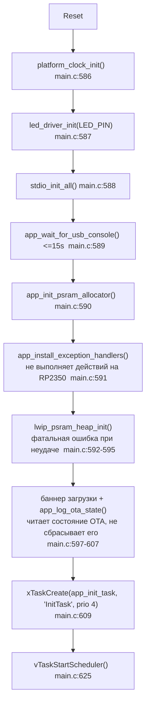
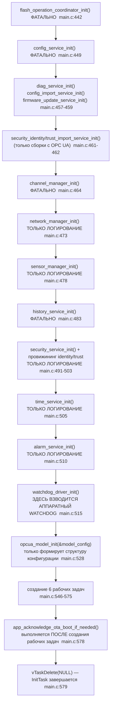

# Порядок запуска

Прослеживает фактическую последовательность загрузки: сброс → (загрузчик) →
`main()` → инициализация платформы → хранилище → сеть → сервисы → OPC UA →
среда выполнения FreeRTOS — как реализовано сейчас, а не как ожидается
концептуально. Все ссылки даны в формате `path:line`.

## От сброса до `main()`

Когда `OTA_BUILD_BOOTLOADER=ON`, первым выполняется `bootloader/main.c`,
который либо переходит в приложение в Bank A, либо зависает, мигая
светодиодом — см. [ota-bootloader.md](ota-bootloader.md) с полным описанием
логики принятия решения о загрузке. Эталонная Debug-сборка из
[AGENTS.md](../../AGENTS.md) использует `OTA_BUILD_BOOTLOADER=OFF`, поэтому в
такой конфигурации напрямую выполняется собственный вектор сброса
приложения.

`main()` — [app/basic_profile/main.c:582](../../app/basic_profile/main.c) —
намеренно делает очень мало сам; он поднимает необходимый минимум для
запуска планировщика, после чего передаёт почти всё остальное задаче
начальной загрузки (bootstrap-задаче):

**Вся инициализация хранилища, сети, сервисов и OPC UA происходит внутри
`InitTask` уже после запуска планировщика** — `main()` не выполняет её
последовательно напрямую.

## `InitTask` (`app_init_task`, `main.c:432-580`)

Приоритет 4, стек 6 КиБ. Последовательность с указанием обработки ошибок
(некоторые шаги **фатальны** — через `app_fault_loop`, другие только
**логируются**, и загрузка продолжается):

| Шаг | Поведение при ошибке | Ссылка |
| --- | --- | --- |
| `flash_operation_coordinator_init()` | фатально (`app_fault_loop`) | `main.c:442-447` |
| `config_service_init()` | фатально | `main.c:449-454` |
| `channel_manager_init()` | фатально | `main.c:464-469` |
| `history_service_init()` | фатально | `main.c:483-488` |
| `network_manager_init()` | **только логирование** — загрузка продолжается без сети | `main.c:473-476` |
| `sensor_manager_init()` | **только логирование** | `main.c:478-481` |
| `security_service_init()` + провижининг | **только логирование** | `main.c:491-503` |
| `time_service_init()` | **только логирование** | `main.c:505-508` |
| `alarm_service_init()` | **только логирование** | `main.c:510-513` |

Таким образом устройство может полностью загрузиться без работающего
сетевого менеджера и сервиса времени; `OpcUaTask` просто блокируется
навсегда в ожидании `network_manager_is_ready()`
(`opcua_model/src/model_core_lifecycle.c:636-646`).

## Замечания по порядку выполнения (как реализовано, не исправляется в рамках этой доработки)

1. **Watchdog взводится до создания `OpcUaTask`.** `watchdog_driver_init()`
   (`main.c:515-517`, → `watchdog_enable()`,
   `drivers/src/watchdog_driver.c:20`) выполняется до создания любой рабочей
   задачи; ничто не "пинает" его, пока ближе к концу `InitTask` не будет
   создана `WatchdogTask` (`main.c:559-575`). Таймаут по умолчанию — 80 с
   (`APP_DEFAULT_WATCHDOG_TIMEOUT_MS`, `main.c:54`).
2. **Двухфазная инициализация OPC UA.** `opcua_model_init()` синхронно
   формирует конфигурацию модели в памяти внутри `InitTask`, ещё до
   поднятия сети; собственно работа `UA_Server_newWithConfig()`/
   `UA_Server_run_iterate()` происходит позже, уже внутри `OpcUaTask`,
   и обусловлена готовностью `network_manager_is_ready()`. См.
   [opcua-flow.md](opcua-flow.md).
3. **Подтверждение OTA не является проверкой работоспособности** — оно
   выполняется последним, уже после того как все рабочие задачи созданы и
   выполняются параллельно. См.
   [ota-bootloader.md](ota-bootloader.md#health-confirmation-and-rollback--current-gap).
4. **Схема приоритетов**: `OpcUaTask` (самый большой стек, 64 КиБ)
   выполняется с *самым низким* прикладным приоритетом (1);
   `NetworkTask` следующая (2); `SensorTask`/`TimeTask`/`AlarmTask`/
   `WatchdogTask` делят приоритет 3; `InitTask` имеет наивысший приоритет
   (4), но выполняется лишь непродолжительное время. Полную таблицу задач
   см. в [freertos.md](freertos.md).

## Платы и выбор платы

`boards/` содержит только заголовочные файлы — без `CMakeLists.txt` —
подключается через `PICO_BOARD_HEADER_DIRS` (корневой `CMakeLists.txt:19-25`).
`PICO_BOARD` определяется паком драйверов: `FIRMWARE_DRIVER_PACK=base` (по
умолчанию) — `waveshare_core2350b_16mb_psram8mb`, `industrial` —
`rp2350_industrial_mvp_v1.h` (PSRAM CS на GPIO0, без выводов UART/I2C/SPI/LED
по умолчанию). Явно заданный `PICO_BOARD`, не совпадающий с паком, даёт
ошибку конфигурации; эталонная сборка передаёт совпадающее значение
([AGENTS.md:199](../../AGENTS.md)). Также существует заголовок платы
`weact_studio_rp2350a_16mb.h`, паком не выбираемый. `WIZNET_CHIP` по умолчанию — `W5500`
(`CMakeLists.txt:31-34`).

## Связанная документация

- [freertos.md](freertos.md) — подробное описание шести задач FreeRTOS.
- [ota-bootloader.md](ota-bootloader.md) — логика принятия решений
  загрузчика и пробел в подтверждении/откате OTA.
- [opcua-flow.md](opcua-flow.md) — жизненный цикл сервера
  `OpcUaTask`/`model_core_task`.
- [modules/app.md](modules/app.md) — детальное описание модуля
  `app/basic_profile`.
